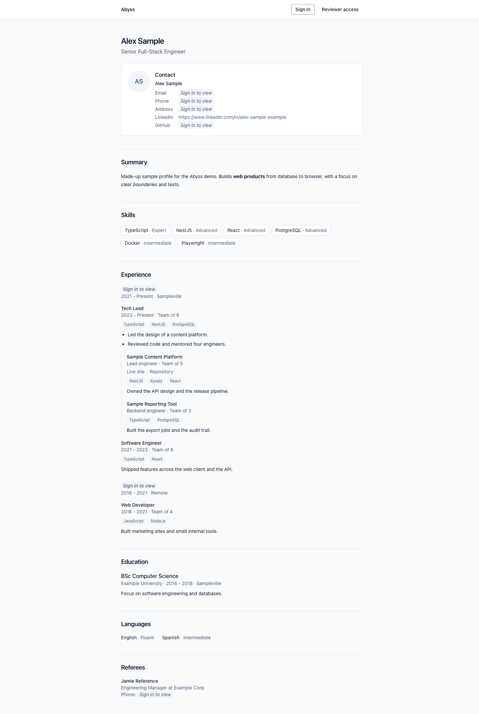
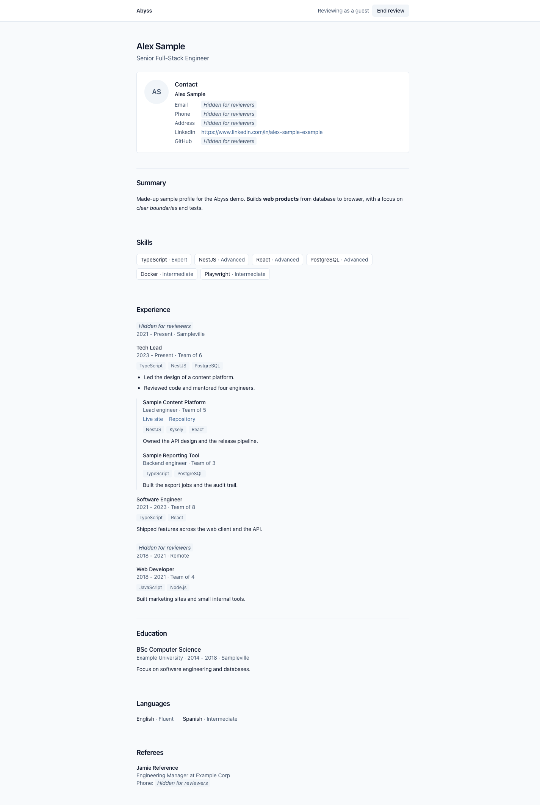
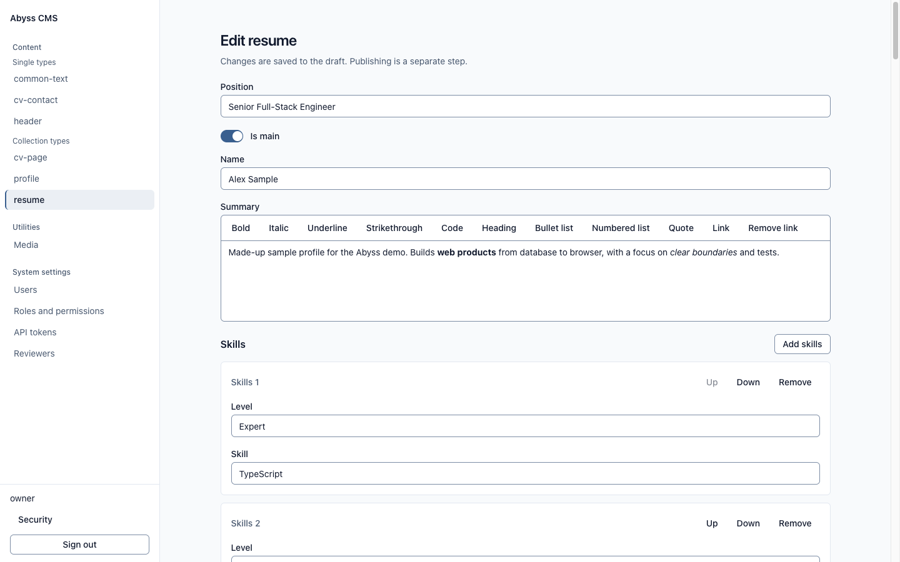
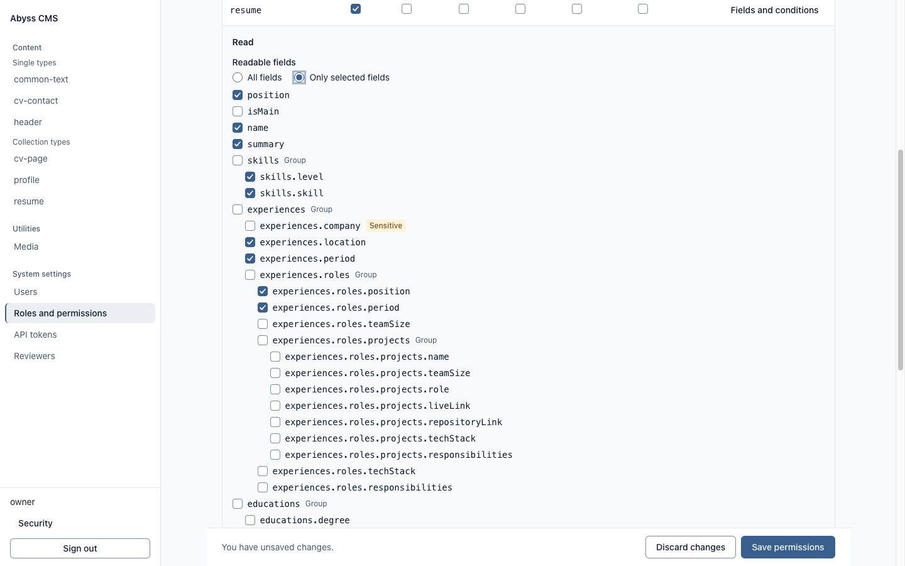
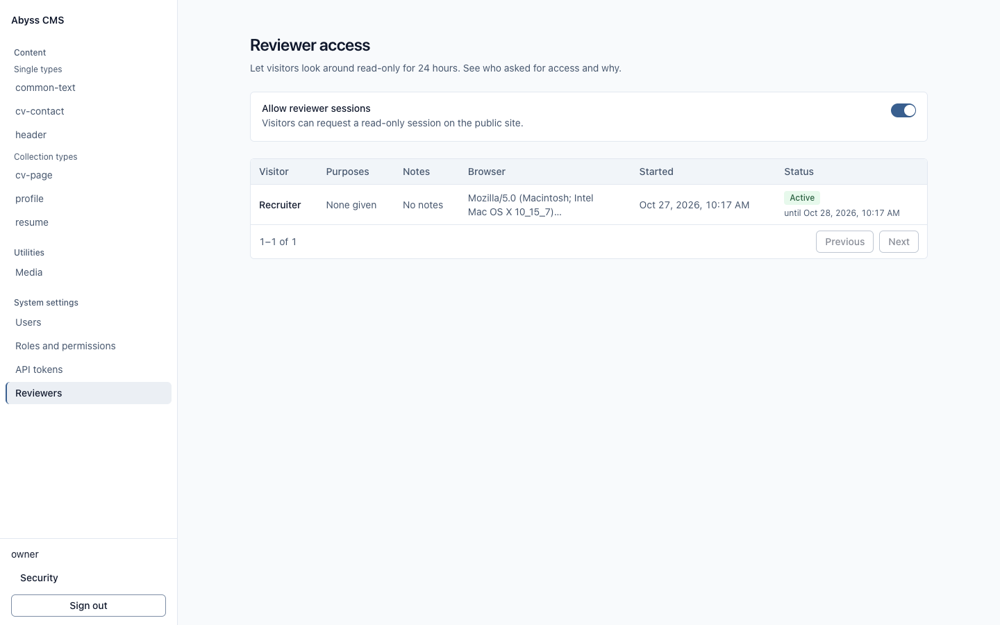

# Abyss

A headless CMS for a personal CV and portfolio, built as a technical showcase. The owner manages and publishes content defined by JSON schemas; it is served over REST and a read-only GraphQL API to a public Next.js site. The point of the project is the set of concerns that hold up under attack: role and field-level access control, draft and publish, an always-on security audit, and a safe reviewer login for visitors. See [SPEC.md](SPEC.md) section 1 for the objective and the threat model.

This repository is not deployed anywhere public yet, so there is no live site to link. You can run all of it on your machine (see Quick start).

## Screenshots



Web CV page as an anonymous visitor: sensitive fields show "Sign in to view" placeholders.



The same page in a reviewer session: the header reads "Reviewing as a guest" and sensitive fields show "Hidden for reviewers".



Admin content editor on the resume document: position, name, rich-text summary and repeatable skills groups.



Admin role editor: per-field read permissions on the resume type, with sensitive fields flagged.



Admin reviewer access page: the switch for reviewer sessions and a table of who requested access.

## What it does

Each point links to the document that describes it.

- **Field-level access control:** hybrid RBAC with per-field permissions; masked fields come back as `***` for anonymous and reviewer actors. [docs/modules/access-control.md](docs/modules/access-control.md), [SPEC.md](SPEC.md) section 7.
- **Content defined by JSON schemas:** content types, nested components and draft and publish. [docs/modules/content-schema.md](docs/modules/content-schema.md).
- **Read-only GraphQL API** for document reads, next to the REST API. [docs/modules/graphql.md](docs/modules/graphql.md), [ADR 0003](docs/adr/0003-graphql-read-gateway.md).
- **Security audit:** an append-only audit log of sign-ins and sensitive actions. [docs/modules/core-schema.md](docs/modules/core-schema.md).
- **Reviewer access:** a self-service, 24-hour, read-only session protected by Cloudflare Turnstile and rate limits, which the owner can switch on or off. [SPEC.md](SPEC.md) section 7, [docs/modules/access-control.md](docs/modules/access-control.md).
- **One-time owner setup** with a setup token. [docs/modules/owner-setup.md](docs/modules/owner-setup.md), [ADR 0005](docs/adr/0005-one-time-owner-setup-route.md).
- **Clean-architecture layers in the API,** enforced by architecture tests. [ADR 0006](docs/adr/0006-cms-api-clean-architecture-layers.md).
- **Automated success criteria:** each item in [SPEC.md](SPEC.md) section 12 is meant to be an automated test; the current gaps are listed in [docs/modules/success-criteria.md](docs/modules/success-criteria.md).

## Tech stack

Full table: [SPEC.md](SPEC.md) section 3.

- `apps/cms-api`: NestJS 11, Prisma, Kysely, PostgreSQL 16
- `apps/cms-admin`: React 19, Vite, Tailwind CSS, Redux Toolkit, TanStack Query
- `apps/web`: Next.js 16 (App Router), React 19
- `apps/e2e`: Playwright (Chromium)
- `packages/form-commons`: shared React form components (shadcn/Radix)
- `packages/base-config`: shared lint, format and TypeScript config
- Monorepo: pnpm 11 workspaces, Turborepo, Node 24 or newer, TypeScript

## Quick start

Needs Docker (running), Node 24 or newer and pnpm 11. Use a Chromium-based browser, which resolves `*.localhost` names.

```
pnpm install
pnpm demo
pnpm dev:stack:stop     # when you are done
```

`pnpm demo` starts Postgres and a mail catcher in containers and the three apps in dev mode, and turns reviewer access on. It prints the web, admin and mail addresses. Open the web and choose Reviewer access (needs internet for the Turnstile widget). Signing in to the admin locally needs a separate owner setup: see "Create the one owner account" in [docs/local-run.md](docs/local-run.md). That guide also covers the other ways to run the stack.

## Where to look

- [SPEC.md](SPEC.md): objective, scope, stack, security decisions, data model, API outline, success criteria.
- [docs/adr/](docs/adr): architecture decision records.
- [docs/modules/](docs/modules): one page per module.
- [docs/architecture/](docs/architecture): ten diagram pages as HTML. GitHub shows HTML as source, so open them locally, for example `open docs/architecture/project-architecture.html` on macOS, or open the file in a browser.
- [.github/workflows/](.github/workflows): CI.
- [apps/e2e](apps/e2e): browser tests ([README](apps/e2e/README.md)).
- [docs/deployment/](docs/deployment) and [docs/ci-cd.md](docs/ci-cd.md): deployment and pipeline notes.

## Repository map

- `apps/`: `cms-api`, `cms-admin`, `web`, `e2e`; each has its own README.
- `packages/`: `form-commons`, `base-config`.
- `docs/`: ADRs, module pages, architecture pages, deployment and local-run guides.
- `scripts/`: the demo and dev stack, the smoke stack, and the architecture page generator.
- `tasks/`: the plan and task list ([plan.md](tasks/plan.md), [todo.md](tasks/todo.md)) that drove the build, one task at a time with acceptance criteria.
- `.claude/`: the agent workflow used to build the project (agent roles, skills and the shared state files). It is kept in the repository on purpose, so the process is visible.

## License

Copyright (c) 2026 AbyssOfTime Dev. All rights reserved. See [LICENSE](LICENSE): no use, copying, modification or sale without the owner's prior written permission.
