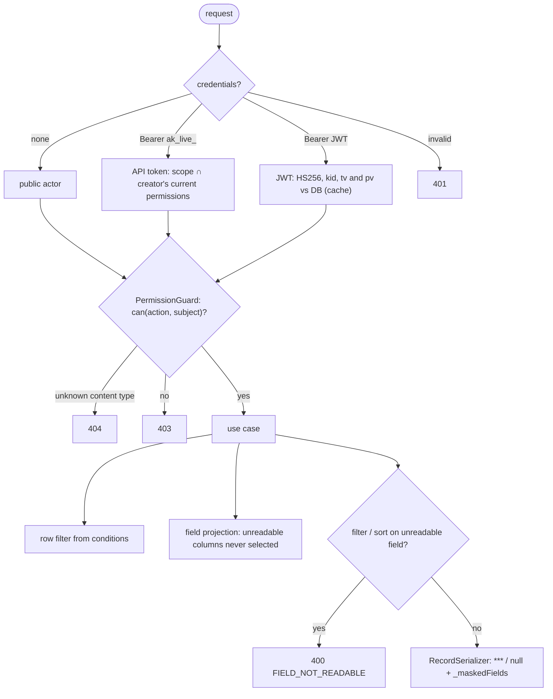

# cms-api: flows

Part of the [project spec](../../../SPEC.md). App `cms-api`: [SPEC.md](SPEC.md) · [FLOW.md](FLOW.md) · [RULES.md](RULES.md). In these files a section without an `Applies to:` line covers every flow that touches this app.

## Request pipeline

1. The request reaches cms-api under `/api/v1` (Traefik never strips the prefix; trailing slashes are tolerated, [canonical-values.md](../../global/reference/canonical-values.md)).
2. The shared HTTP pipeline (`src/common`) adds the request id and security headers, resolves the client IP (D7) and applies the throttles.
3. Guards authenticate (JWT, API token, or anonymous for document reads) and check the permission for the action and subject.
4. The controller parses the body with the module's Zod request schema; the use case runs with an explicit `ActorContext`.
5. Any error is answered by the one exception filter as `{ statusCode, errorCode, message, details?, requestId }`.

## Authorization decision (every content request)

Applies to flows: `content-editing`, `public-site`, `reviewer`.

## Deploy and migrate

Applies to flows: `content-modeling`, `backups`.

1. The init container runs `deploy:migrate` (`db:migrate` then `content:migrate`) as `abyss_migrator`, with only the `DB_*` keys loaded (D19).
2. `db:migrate` applies the Prisma core migrations and seeds the system roles; `content:migrate` applies the generated content migrations under an advisory lock and records them in `content._migrations`.
3. cms-api starts as `abyss_api`; in production it logs one warning (names only) when its role can create objects or owns them (D19).
