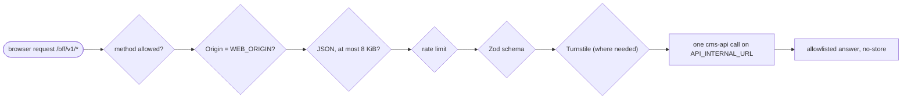

# web: flows

Part of the [project spec](../../../SPEC.md). App `web`: [SPEC.md](SPEC.md) (app-wide requirements and decisions) · [FLOW.md](FLOW.md) (processes every flow of the app goes through) · [RULES.md](RULES.md) (rules every flow of the app must keep). In these files `Applies to: all flows.` means every flow that touches this app.

## BFF request pipeline

Applies to flows: `sign-in`, `public-site`.

Every BFF route, in this order (D21):

1. Allowed method only.
2. State-changing routes need `Origin` exactly `WEB_ORIGIN`, and `Sec-Fetch-Site` (when sent) `same-origin`.
3. POST bodies are `application/json` only, at most 8 KiB.
4. Per-IP fixed-window rate limit (`auth` 20 / 60 s, `read` 120 / 60 s).
5. Zod schema per body: unknown keys refused, lengths capped.
6. Turnstile check where the route needs one.
7. The one upstream cms-api call, with `API_TIMEOUT_MS`, the forwarded client IP (D7) and only the headers that call needs.
8. The answer holds allowlisted fields only; errors are `{ statusCode, errorCode, message }`; `Cache-Control: no-store`.

## Page render

Applies to flows: `public-site`.

1. `src/proxy.ts` creates the per-request nonce and sets the CSP header (D17).
2. Server Components fetch content anonymously through GraphQL from `API_INTERNAL_URL`, cached for `WEB_REVALIDATE_SECONDS`.
3. Client components call only the BFF under `/bff/v1`, through the browser API client.
