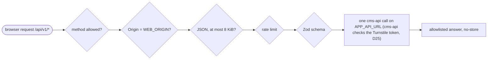

# web: flows

Part of the [project spec](../../../SPEC.md). App `web`: [SPEC.md](SPEC.md) · [FLOW.md](FLOW.md) · [RULES.md](RULES.md). In these files a section without an `Applies to:` line covers every flow that touches this app.

## BFF request pipeline

Applies to flows: `sign-in`, `public-site`.

Every BFF route, in this order (D21):

1. Allowed method only.
2. State-changing routes need `Origin` exactly `WEB_ORIGIN`, and `Sec-Fetch-Site` (when sent) `same-origin`.
3. POST bodies are `application/json` only, at most 8 KiB.
4. Per-IP fixed-window rate limit (`auth` 20 / 60 s, `read` 120 / 60 s).
5. Zod schema per body: unknown keys refused, lengths capped.
6. The one upstream cms-api call (a sign-in route forwards the body's `turnstileToken`; cms-api checks it, D25), with `API_TIMEOUT_MS`, the forwarded client IP (D7) and only the headers that call needs.
7. The answer holds allowlisted fields only; errors are `{ statusCode, errorCode, message }`; `Cache-Control: no-store`.

## Page render

Applies to flows: `public-site`.

1. `src/proxy.ts` creates the per-request nonce and sets the CSP header (D17).
2. The header runs its header and sign-in queries and the page its page query (public-site PS-1), through server GraphQL → server RESTful on `APP_API_URL` with `APP_API_TOKEN`, each cached for its own revalidate seconds (default 180 s, WEB-4).
3. Where `APP_ENV` is not `production` (WEB-9), a query whose read failed (GraphQL `errors` with HTTP 200 included, or a single type that answers null), is answered from `MockView.ts` by its mock key, above the fetch and never cached; otherwise `executeGraphql` throws and the part shows its error state or its last-resort text. A collection that answers empty is never mocked: its page shows 404 or a no-data state (WEB-5).
4. Client components get their text as props from the server component of their part and call only the BFF under `/api/v1`, through the client RESTful layer (WEB-1, WEB-3).
