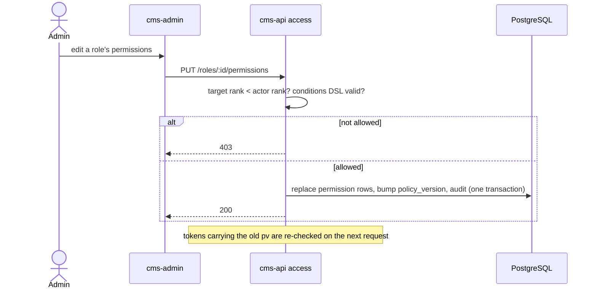

# Access administration: flow

Part of the [project spec](../../../SPEC.md). Flow `access-admin`: [SPEC.md](SPEC.md) (what it must do) · [FLOW.md](FLOW.md) (steps and modules) · [RULES.md](RULES.md) (rules every change must keep).

## Actors

- **Admin** (rank 40): manages accounts, roles and tokens strictly below rank 40, and only the tokens they created.
- **Owner** (rank 100): everything; manages all tokens.
- **cms-api access**: rank rule, policy versions, token checks.

## Steps

1. Invite: `POST /accounts` with an email and a role below the actor's rank; the invitee receives a code and sets a password ([password](../password/FLOW.md)).
2. Manage: `PATCH /accounts/:id`, disable / enable (Q7), resend invite (Q8, throttle Q9), revoke sessions; each checks target rank < actor rank.
3. Roles: create a custom role (rank 11–39), edit its permissions with `PUT /roles/:id/permissions`; the change bumps `policy_version` and takes effect on the next request.
4. API tokens: create from a JWT session with a scope that is a subset of the creator's permissions; the raw value is shown once; update re-checks the subset; revoke.
5. Each change writes an audit row (D15).

## Modules in this flow

<!-- flow-modules:start (generated by .claude/bin/module-index from `modules:`; edit only the Role column) -->
<!-- prettier-ignore-start -->

| Module | Role in this flow | Doc |
|---|---|---|
| `apps/cms-api/src/modules/access` | Policy, rank rules, accounts, roles, permissions and API tokens (`access/management/`) | [access-control.md](../../modules/access-control.md) |
| `apps/cms-api/src/modules/identity` | Invitation codes and session revocation used by account actions | [identity.md](../../modules/cms-api/identity.md) |
| `apps/cms-api/src/modules/content-types` | Content type catalog that feeds the permission matrix | [content-types.md](../../modules/cms-api/content-types.md) |
| `apps/cms-api/src/modules/security-audit` | Audit rows for role, permission, account and token changes (D15) | [security-audit.md](../../modules/cms-api/security-audit.md) |
| `apps/cms-api/src/infrastructure/mail` | Sends invitations | none yet |
| `apps/cms-admin/src/features/access` | Accounts, roles and permission matrix client; the caller's access hints | [access.md](../../modules/cms-admin/access.md) |
| `apps/cms-admin/src/views/accounts` | Accounts list and invite | none yet |
| `apps/cms-admin/src/views/roles` | Roles list | none yet |
| `apps/cms-admin/src/views/role-permissions` | Permission matrix of one role | none yet |
| `apps/cms-admin/src/views/api-tokens` | API tokens | none yet |

<!-- prettier-ignore-end -->
<!-- flow-modules:end -->
