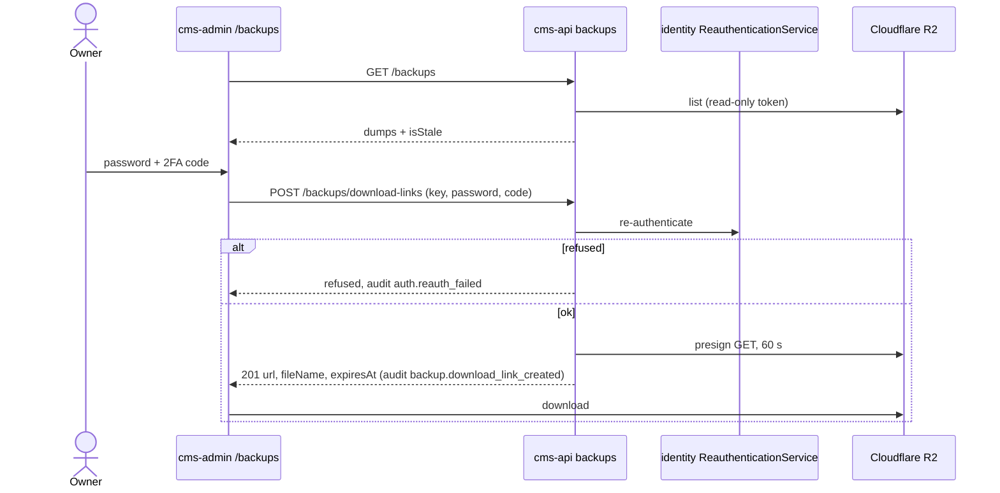

# Backups: flow

Part of the [project spec](../../../SPEC.md). Flow `backups`: [SPEC.md](SPEC.md) (what it must do) · [FLOW.md](FLOW.md) (steps and modules) · [RULES.md](RULES.md) (rules every change must keep).

## Actors

- **Owner**: the only actor; no role grant opens this flow.
- **Nightly job** (deploy repo): dumps as `abyss_backup`, encrypts with `age`, uploads to R2.
- **Cloudflare R2**: holds the dumps; cms-api holds a read-only token.

## Steps

1. The job streams `pg_dump -Fc`, encrypts it and uploads it under `daily/` or `monthly/`; bucket lifecycle rules keep 14 and 92 days.
2. The owner opens the backups page; `GET /backups` lists dumps with `isStale`.
3. The owner asks for a link with password and code; `POST /backups/download-links` re-authenticates (failure writes `auth.reauth_failed`) and returns a presigned GET URL valid 60 s, writing `backup.download_link_created`.
4. The browser downloads straight from the R2 S3 API host.

## Modules in this flow

<!-- flow-modules:start (generated by .claude/bin/module-index from `modules:`; edit only the Role column) -->
<!-- prettier-ignore-start -->

| Module | Role in this flow | Doc |
|---|---|---|
| `apps/cms-api/src/modules/backups` | Owner-only list of dumps and presigned download links (read-only R2 client) | [backups.md](../../modules/backups.md) |
| `apps/cms-api/src/modules/identity` | `ReauthenticationService`: password plus a 2FA code | [identity.md](../../modules/cms-api/identity.md) |
| `apps/cms-api/src/modules/security-audit` | `auth.reauth_failed`, `backup.download_link_created` | [security-audit.md](../../modules/cms-api/security-audit.md) |
| `apps/cms-admin/src/features/backups` | Backups API client | none yet |
| `apps/cms-admin/src/views/backups` | Backups page with the staleness warning | none yet |

<!-- prettier-ignore-end -->
<!-- flow-modules:end -->
