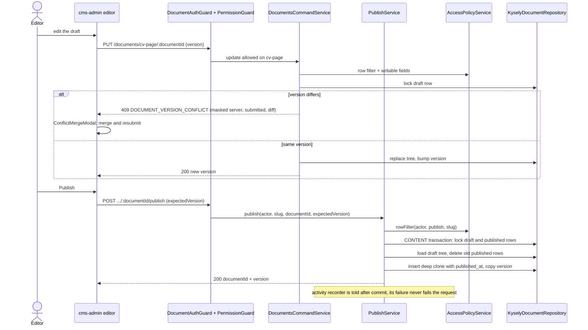

# Content editing: flow

Part of the [project spec](../../../SPEC.md). Flow `content-editing`: [SPEC.md](SPEC.md) (what it must do) · [FLOW.md](FLOW.md) (steps and modules) · [RULES.md](RULES.md) (rules every change must keep).

## Actors

- **Editor / Admin / Owner**: with permissions on the content type.
- **cms-api documents**: commands and queries over the content tables, through the access rules.

## Steps

1. List: `GET /documents/:slug` with status, filter, sort, page; unreadable fields come back masked, filter or sort on them is `400 FIELD_NOT_READABLE`.
2. Edit: the form sends `PUT /documents/:slug/:documentId` with `version`; a stale version answers `409 DOCUMENT_VERSION_CONFLICT` with masked `server`, `submitted` and `diff`, and the merge dialog resubmits.
3. Presence: the editor sends a heartbeat every 20 s; the banner lists other active editors.
4. Publish: `POST …/:documentId/publish` with `expectedVersion`; one CONTENT transaction replaces the published rows with a deep clone of the draft.
5. Bulk (collections only): create, publish, unpublish, delete, each `{ atomic, items }`, at most 50 records.

## Authorization decision

Every content request is authorized as in [apps/cms-api/FLOW.md](../../apps/cms-api/FLOW.md) "Authorization decision".

## Modules in this flow

<!-- flow-modules:start (generated by .claude/bin/module-index from `modules:`; edit only the Role column) -->
<!-- prettier-ignore-start -->

| Module | Role in this flow | Doc |
|---|---|---|
| `apps/cms-api/src/modules/documents` | Document list, read, create, draft save with version check, publish, bulk, presence | [documents.md](../../modules/cms-api/documents.md) |
| `apps/cms-api/src/modules/access` | Row filter, field projection, write allowlist, document auth guard | [access-control.md](../../modules/access-control.md) |
| `apps/cms-api/src/modules/content-engine` | Content storage and definitions | [content-engine.md](../../modules/cms-api/content-engine.md) |
| `apps/cms-api/src/modules/media` | Media references inside documents | [media.md](../../modules/cms-api/media.md) |
| `apps/cms-admin/src/features/content` | Content API client, dynamic document form, field registry, richtext | [content.md](../../modules/cms-admin/content.md) |
| `apps/cms-admin/src/features/content-types` | Content type catalog for the menu and forms | [content-types.md](../../modules/cms-admin/content-types.md) |
| `apps/cms-admin/src/views/collection-list` | Collection list page with bulk actions | [collection-list.md](../../modules/cms-admin/collection-list.md) |
| `apps/cms-admin/src/views/document-edit` | Create and edit page, presence banner, version-conflict merge | [document-edit.md](../../modules/cms-admin/document-edit.md) |
| `packages/form-commons/src/components/forms` | Form inputs (text, number, select, switch, json, date, media, richtext), bulk action bar | [forms.md](../../modules/form-commons/forms.md) |

<!-- prettier-ignore-end -->
<!-- flow-modules:end -->
