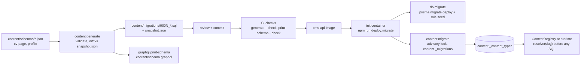

# Content modeling: flow

Part of the [project spec](../../../SPEC.md). Flow `content-modeling`: [SPEC.md](SPEC.md) · [FLOW.md](FLOW.md) · [RULES.md](RULES.md).

## Actors

- **Developer**: writes the JSON schema and reviews the generated migration.
- **CI**: checks `generate --check` and `print-schema --check`.
- **Init container**: runs `deploy:migrate` (`db:migrate` + `content:migrate`) as `abyss_migrator` (D19).

## Steps

1. Write or change `content/schemas/<type>.json` (root + up to 3 component levels).
2. `content:generate` validates it, diffs against `snapshot.json` and writes `content/migrations/000N_*.sql`; `graphql:print-schema` writes the SDL.
3. Review and commit; destructive changes need `--allow-destructive` and a data-migration note.
4. CI checks both outputs; the cms-api image is built.
5. The init container runs `deploy:migrate`; `content:migrate` applies the migration under an advisory lock and records it in `content._migrations`.
6. At runtime the registry (`content._content_types`) resolves each slug before any SQL.

## Modules in this flow

<!-- flow-modules:start (generated by .claude/bin/module-index from `modules:`; edit only the Role column) -->
<!-- prettier-ignore-start -->

| Module | Role in this flow | Doc |
|---|---|---|
| `apps/cms-api/src/modules/content-engine` | Schema validation, migration generator, content storage, field-type registry, `content:generate` / `content:migrate` | [content-engine.md](../../modules/cms-api/content-engine.md) |
| `apps/cms-api/src/modules/content-types` | Read-only catalog of registered types | [content-types.md](../../modules/cms-api/content-types.md) |
| `apps/cms-api/src/modules/graphql` | Schema generated from the definitions; printed SDL `content/schema.graphql` | [graphql.md](../../modules/graphql.md) |
| `apps/cms-api/src/infrastructure/database` | Database connection used by the migration commands | [database.md](../../modules/cms-api/database.md) |

<!-- prettier-ignore-end -->
<!-- flow-modules:end -->
