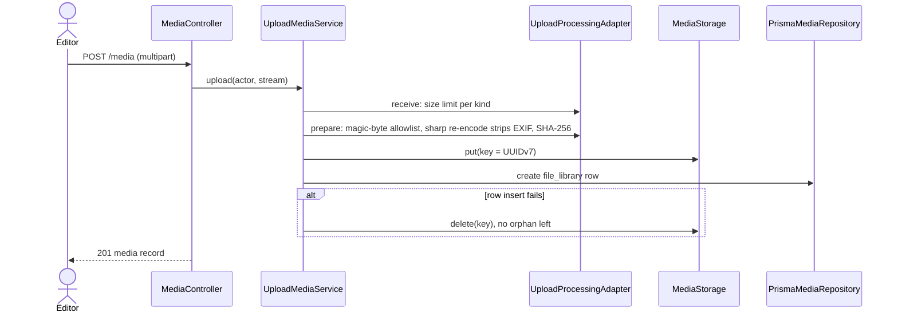
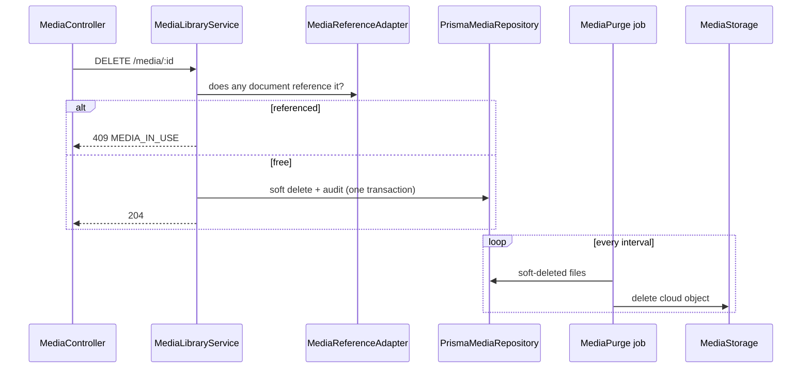

# Media: flow

Part of the [project spec](../../../SPEC.md). Flow `media`: [SPEC.md](SPEC.md) · [FLOW.md](FLOW.md) · [RULES.md](RULES.md).

## Actors

- **Editor**: with media permissions.
- **cms-api media**: receives, checks, re-encodes and stores files.
- **Cloudinary**: stores the objects; keys are UUIDv7.

## Steps

1. The upload dialog sends `POST /media` (multipart) with a 4 min client timeout and a fresh access token (MU-2); the row shows the sent percentage, then an indeterminate bar while the server processes (MU-1).
2. cms-api enforces the size limit per kind, detects the type from magic bytes, re-encodes images (strips EXIF), hashes the bytes and names the file `<stem>_<hash8>.<ext>` (MU-3).
3. The object is stored under a UUIDv7 key, then the `file_library` row is created; if the row fails, the object is deleted.
4. Replace in place: `PUT /media/:id/file` keeps the id and stores the new name and hash.
5. Delete: refused with `409 MEDIA_IN_USE` while a document references the file; otherwise a soft delete plus audit row; the purge job deletes the cloud object later.

## Media delete and purge

## Modules in this flow

<!-- flow-modules:start (generated by .claude/bin/module-index from `modules:`; edit only the Role column) -->
<!-- prettier-ignore-start -->

| Module | Role in this flow | Doc |
|---|---|---|
| `apps/cms-api/src/modules/media` | Upload pipeline, replace, alt text, delete, purge job, storage adapters, media refs; `storedFileNameOf` (MU-3) | [media.md](../../modules/cms-api/media.md) |
| `apps/cms-api/src/modules/security-audit` | Audit row for media delete (D15) | [security-audit.md](../../modules/cms-api/security-audit.md) |
| `apps/cms-api/src/infrastructure/scheduling` | Runs the purge job | [scheduling.md](../../modules/cms-api/scheduling.md) |
| `apps/cms-admin/src/features/media` | Media API client, upload queue and dialog, grid, picker (MU-1, MU-2, MU-4) | [media.md](../../modules/cms-admin/media.md) |
| `apps/cms-admin/src/features/auth` | Fresh token before an upload (MU-2) | [auth.md](../../modules/cms-admin/auth.md) |
| `apps/cms-admin/src/views/media-library` | The File Library page (`/media`) | [media-library.md](../../modules/cms-admin/media-library.md) |
| `packages/form-commons/src/components/forms` | `media-input/`: `MediaInput`, `MediaDetails`, `FileName` (MU-4, MU-5) | [forms.md](../../modules/form-commons/forms.md) |

<!-- prettier-ignore-end -->
<!-- flow-modules:end -->
