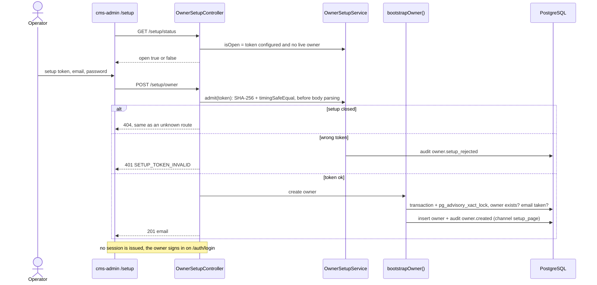

# Owner setup: flow

Part of the [project spec](../../../SPEC.md). Flow `owner-setup`: [SPEC.md](SPEC.md) (what it must do) · [FLOW.md](FLOW.md) (steps and modules) · [RULES.md](RULES.md) (rules every change must keep).

## Actors

- **Operator**: holds the setup token (Kubernetes Secret `OWNER_SETUP_TOKEN`) or a shell for the CLI.
- **cms-admin `/setup`**: shown only while `GET /setup/status` says `open`.
- **cms-api identity**: `bootstrapOwner`, shared by the route and the CLI.

## Steps

1. cms-admin asks `GET /setup/status` (no token); open = token configured and no live owner.
2. The operator enters the setup token, email and password; `POST /setup/owner`.
3. cms-api checks the token first (SHA-256 digests, `timingSafeEqual`); closed → 404, wrong → 401 `SETUP_TOKEN_INVALID` with an `owner.setup_rejected` audit row.
4. `bootstrapOwner` creates the owner in one transaction with `pg_advisory_xact_lock` and writes `owner.created` (channel `setup_page`); answer `201 { email }`, no session.
5. The owner signs in on the login page (email prefilled, Q-OS1); the operator removes `OWNER_SETUP_TOKEN`.
6. Fallback: `owner:bootstrap` CLI (channel `cli`).

## Modules in this flow

<!-- flow-modules:start (generated by .claude/bin/module-index from `modules:`; edit only the Role column) -->
<!-- prettier-ignore-start -->

| Module | Role in this flow | Doc |
|---|---|---|
| `apps/cms-api/src/modules/identity` | `bootstrapOwner`, setup route, `owner:bootstrap` and `seed:account` CLIs | [identity.md](../../modules/cms-api/identity.md) |
| `apps/cms-api/src/modules/security-audit` | `owner.created`, `owner.setup_rejected`, `account.seeded` (D15) | [security-audit.md](../../modules/cms-api/security-audit.md) |
| `apps/cms-admin/src/features/auth` | Setup status check and the setup request | [auth.md](../../modules/cms-admin/auth.md) |
| `apps/cms-admin/src/views/owner-setup` | The one-time setup page | [owner-setup.md](../../modules/cms-admin/owner-setup.md) |

<!-- prettier-ignore-end -->
<!-- flow-modules:end -->
