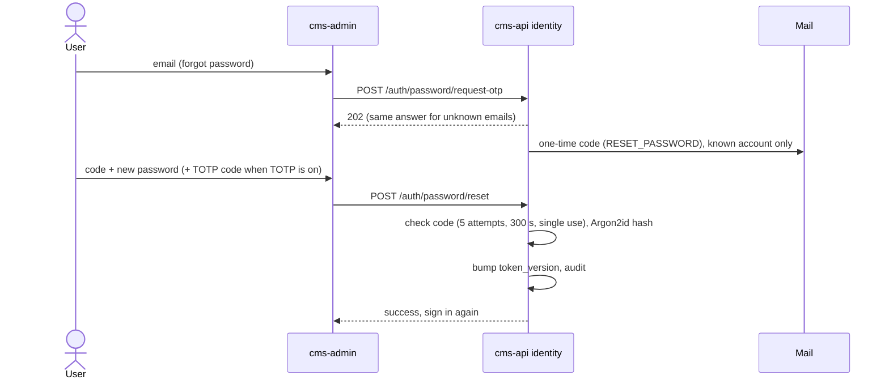

# Password: flow

Part of the [project spec](../../../SPEC.md). Flow `password`: [SPEC.md](SPEC.md) · [FLOW.md](FLOW.md) · [RULES.md](RULES.md).

## Actors

- **Invitee**: an account in status `invited`, setting its first password.
- **User**: an account that forgot its password, or a signed-in account changing it.
- **cms-api identity**: issues and checks one-time codes (OTP), hashes passwords, ends sessions.

## Steps

1. Set password: the invitee opens the invitation, enters the emailed code and a new password; `POST /auth/password/set` checks the code (purpose `INVITE_SET_PASSWORD`) and activates the account.
2. Forgot: the user asks for a code; `POST /auth/password/request-otp` answers 202 whether or not the email exists, and mails a code (purpose `RESET_PASSWORD`) only to a known account, within the issue limit.
3. Reset: `POST /auth/password/reset` with the code, the new password and, when TOTP is on, a TOTP code; success bumps `token_version`.
4. Change: a signed-in user sends the current and the new password to `POST /auth/password/change`; success bumps `token_version` and ends every session.
5. Each change writes an audit row (D15).

## Modules in this flow

<!-- flow-modules:start (generated by .claude/bin/module-index from `modules:`; edit only the Role column) -->
<!-- prettier-ignore-start -->

| Module | Role in this flow | Doc |
|---|---|---|
| `apps/cms-api/src/modules/identity` | OTP issue and check, password set, reset and change, `token_version` bump | [identity.md](../../modules/cms-api/identity.md) |
| `apps/cms-api/src/modules/security-audit` | Audit rows for password changes (D15) | [security-audit.md](../../modules/cms-api/security-audit.md) |
| `apps/cms-api/src/infrastructure/mail` | Sends the one-time codes | [mail.md](../../modules/cms-api/mail.md) |
| `apps/cms-admin/src/features/auth` | Password form, setup and password error mapping | [auth.md](../../modules/cms-admin/auth.md) |
| `apps/cms-admin/src/views/set-password` | Invitation acceptance page | [set-password.md](../../modules/cms-admin/set-password.md) |
| `apps/cms-admin/src/views/reset-password` | Forgot and reset password page | [reset-password.md](../../modules/cms-admin/reset-password.md) |
| `apps/cms-admin/src/views/change-password` | Signed-in password change (`/settings/password`) | [change-password.md](../../modules/cms-admin/change-password.md) |

<!-- prettier-ignore-end -->
<!-- flow-modules:end -->
