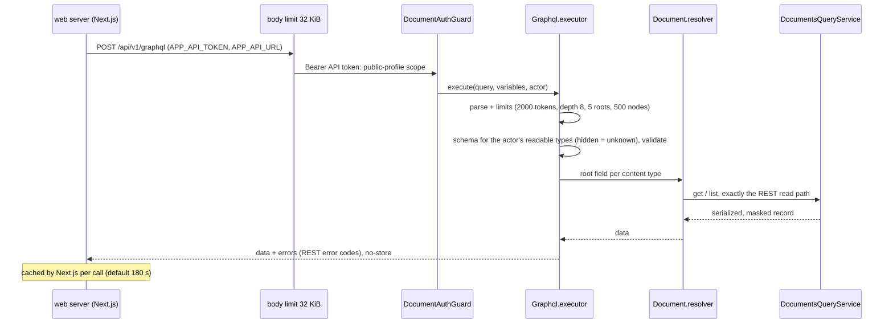

# Public site: flow

Part of the [project spec](../../../SPEC.md). Flow `public-site`: [SPEC.md](SPEC.md) · [FLOW.md](FLOW.md) · [RULES.md](RULES.md).

## Actors

- **Visitor**: anonymous, or signed in on the web site ([sign-in](../sign-in/FLOW.md)).
- **web server (Next.js)**: renders pages, runs the BFF, reads cms-api on `APP_API_URL`.
- **cms-api graphql**: the read-only GraphQL API.

## Steps

1. The visitor opens a link `/cv/<documentId>` the owner shared (PS-5); the Next server renders `PageCv` for that `documentId` with a per-request CSP nonce (D17), the not-found page (HTTP 404) when the id is malformed or has no published CV, or the no-CV-live state when its read failed with no mock (PS-2). Every `/cv` response carries the no-index and no-store headers of PS-5. A signed-in visitor's view reads it again through `GET /api/v1/cv/{documentId}` (D21).
2. The server posts the page's GraphQL operations (PS-1) to `/api/v1/graphql` with `APP_API_TOKEN` (WEB-2); cms-api applies limits, builds the schema for the actor's readable types and resolves through `DocumentsQueryService` (masked).
3. Next.js caches each answer for its own revalidate seconds (default 180 s, WEB-4); where WEB-5 allows, a failed query (a null single type included) comes from the mocks; an empty list never does.
4. Richtext is sanitized again with DOMPurify when rendering (D13).
5. The homepage `/` and `/status` show only the module status card, which polls `GET /api/v1/health` and loads no CV data (D21, Q-BFF2, Q-PS5).
6. A crawler reads `/robots.txt`, follows its `Sitemap:` line to `/sitemap.xml` and reads the pages listed there (`/` and `/status`); a crawler that keeps to `robots.txt` never fetches `/cv` in production (`Disallow: /cv`); a browser fetches `/favicon.ico`. The web server answers all three itself from its own config, without a cms-api call (PS-4). On the admin host, cms-admin's `/robots.txt` disallows everything (PS-4).
7. On a CV, the visitor presses the print button; the browser opens its print dialog and prints, or saves as PDF, the CV as shown, in the print layout of the reference; the site header and every control stay off the paper (PS-7). Nothing is sent to the server.
8. The hosting's OneShield sends `GET /health` to `<domain>` every 10 s; the web server answers 200 `{"status":"ok"}` itself, without a cms-api call; the image health check uses the same route, the pod probes stay as they are (PS-8).

## Modules in this flow

<!-- flow-modules:start (generated by .claude/bin/module-index from `modules:`; edit only the Role column) -->
<!-- prettier-ignore-start -->

| Module | Role in this flow | Doc |
|---|---|---|
| `apps/cms-api/src/modules/graphql` | Read-only GraphQL endpoint over document reads (D18) | [graphql.md](../../modules/graphql.md) |
| `apps/web/src/apis/server` | Server RESTful and GraphQL layers: API token, per-call cache, mock fallback (WEB-1..WEB-5) | [apis-server.md](../../modules/web/apis-server.md) |
| `apps/cms-api/src/modules/documents` | `DocumentsQueryService`, the one read path | [documents.md](../../modules/cms-api/documents.md) |
| `apps/cms-api/src/modules/access` | Document auth guard, public field profile, masking | [access-control.md](../../modules/access-control.md) |
| `apps/cms-api/src/modules/health` | Health endpoints behind the status card | [health.md](../../modules/cms-api/health.md) |
| `apps/web/src/views/cv` | CV page | [views-cv.md](../../modules/web/views-cv.md) |
| `apps/web/src/features/status` | Service status card (`GET /api/v1/health`) | [status.md](../../modules/web/status.md) |
| `apps/web/src/views/status` | Status view | [views-status.md](../../modules/web/views-status.md) |
| `apps/web/src/features/session` | Who is signed in, for `GET /api/v1/cv/{documentId}` | [session.md](../../modules/web/session.md) |
| `apps/web/src/features/crawler-files` | `robots.txt` and `sitemap.xml`, per request (PS-4) | [crawler-files.md](../../modules/web/crawler-files.md) |
| `apps/web/src/features/site-header` | The header query: app name, navs and sub navs (PS-1) | [site-header.md](../../modules/web/site-header.md) |
| `apps/cms-api/src/modules/content-engine` | The `linkOnly` type option in the registry (CM-13) | [content-engine.md](../../modules/cms-api/content-engine.md) |

<!-- prettier-ignore-end -->
<!-- flow-modules:end -->
