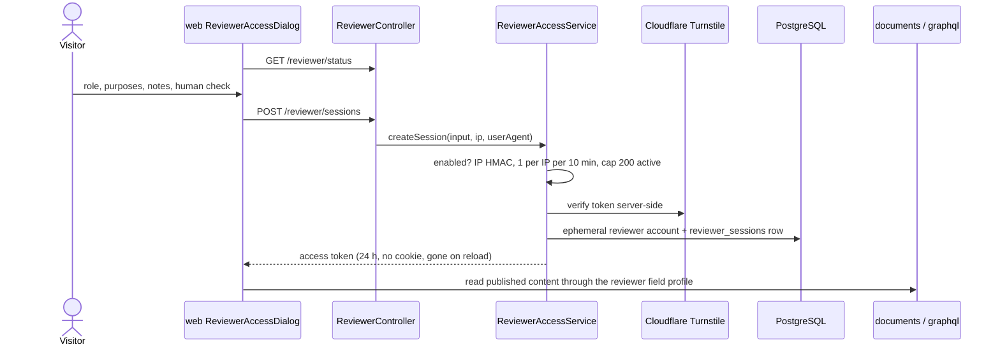

# Reviewer: flow

Part of the [project spec](../../../SPEC.md). Flow `reviewer`: [SPEC.md](SPEC.md) (what it must do) · [FLOW.md](FLOW.md) (steps and modules) · [RULES.md](RULES.md) (rules every change must keep).

## Actors

- **Visitor**: asks for a reviewer session.
- **Owner**: turns the toggle on or off and reads the session log.
- **Cloudflare Turnstile**: the human check.

## Steps

1. `GET /reviewer/status` tells whether reviewer access is open (switch on, toggle on, Turnstile and `OTP_PEPPER` configured).
2. The visitor picks a role and purposes, adds notes, passes the human check; `POST /reviewer/sessions`.
3. cms-api checks the switch first (404 while off), then 1 session per IP per 10 min and the cap of 200 active, verifies Turnstile server-side, creates an ephemeral `reviewer` account and a `reviewer_sessions` row, and returns a 24 h access token.
4. The reviewer reads published content through the `reviewer` field profile; drafts and writes are refused.
5. The owner reads `GET /reviewer/sessions`; turning the toggle off revokes live sessions; a cleanup job removes expired ones.

The diagram predates D21, which removes the web reviewer dialog.

## Modules in this flow

<!-- flow-modules:start (generated by .claude/bin/module-index from `modules:`; edit only the Role column) -->
<!-- prettier-ignore-start -->

| Module | Role in this flow | Doc |
|---|---|---|
| `apps/cms-api/src/modules/reviewer` | Reviewer toggle, session creation, field profile, owner log, cleanup job | [reviewer.md](../../modules/cms-api/reviewer.md) |
| `apps/cms-api/src/modules/access` | `reviewer` role field profile, masking | [access-control.md](../../modules/access-control.md) |
| `apps/cms-api/src/modules/identity` | Reviewer access tokens; `AccessSessionService` refuses reviewer accounts while the switch is off | [identity.md](../../modules/cms-api/identity.md) |
| `apps/cms-api/src/modules/security-audit` | Audit row for the reviewer toggle (D15) | [security-audit.md](../../modules/cms-api/security-audit.md) |
| `apps/cms-admin/src/features/reviewer` | Reviewer switch and session log client | [reviewer.md](../../modules/cms-admin/reviewer.md) |
| `apps/cms-admin/src/views/reviewer-sessions` | Reviewer switch and reviewer session log page (`/reviewer`) | [reviewer-sessions.md](../../modules/cms-admin/reviewer-sessions.md) |
| `apps/web/src/features/reviewer` | Web reviewer access dialog; removed by D21 (web-bff-hardening) | [reviewer.md](../../modules/web/reviewer.md) |

<!-- prettier-ignore-end -->
<!-- flow-modules:end -->
