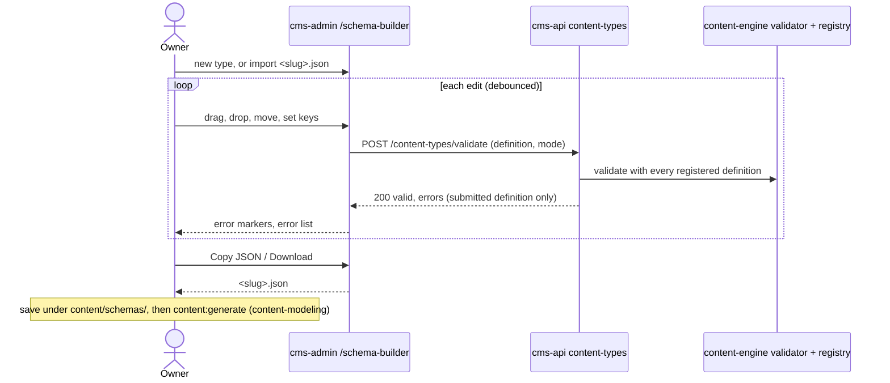

# Schema builder: flow

Part of the [project spec](../../../SPEC.md). Flow `schema-builder`: [SPEC.md](SPEC.md) · [FLOW.md](FLOW.md) · [RULES.md](RULES.md).

## Actors

- **Owner** (as developer): the only actor; no role grant opens this flow (SB-1).
- **cms-api**: validates the definition against the registered types; stores nothing (SB-10).

## Steps

1. The owner opens `/schema-builder` from the System settings menu (SB-1).
2. The owner starts a new content type or imports an existing schema file (SB-2, SB-3).
3. The owner drops field types from the palette onto the canvas, moves and nests them (up to 3 component levels) and sets their keys in the property panel (SB-4..SB-8).
4. After each pause, cms-admin sends the definition to `POST /content-types/validate` and marks the errors on the canvas and in the list (SB-9..SB-11).
5. With no errors, the owner copies or downloads `<slug>.json` (SB-12) and sees the next steps (SB-14).
6. The developer saves the file under `apps/cms-api/content/schemas/` and continues with [content-modeling](../content-modeling/FLOW.md) step 2.

## Modules in this flow

<!-- flow-modules:start (generated by .claude/bin/module-index from `modules:`; edit only the Role column) -->
<!-- prettier-ignore-start -->

| Module | Role in this flow | Doc |
|---|---|---|
| `apps/cms-api/src/modules/content-types` | Serves `POST /content-types/validate` (SB-10) | [content-types.md](../../modules/cms-api/content-types.md) |
| `apps/cms-api/src/modules/content-engine` | Owns the definition validator and the registry the endpoint checks against | [content-engine.md](../../modules/cms-api/content-engine.md) |
| `apps/cms-api/src/modules/access` | `requireOwnerActor`, the hard owner rule of the endpoint | [access-control.md](../../modules/access-control.md) |
| `apps/cms-admin/src/features/content-types` | Client of the validate endpoint | [content-types.md](../../modules/cms-admin/content-types.md) |
| `apps/cms-admin/src/components` | Side menu item (owner only) | [components.md](../../modules/cms-admin/components.md) |
| `apps/cms-admin/src/views/schema-builder` | The `/schema-builder` page: canvas, property panel, live check and JSON export (SB-1..SB-14) | [schema-builder.md](../../modules/cms-admin/schema-builder.md) |

<!-- prettier-ignore-end -->
<!-- flow-modules:end -->
