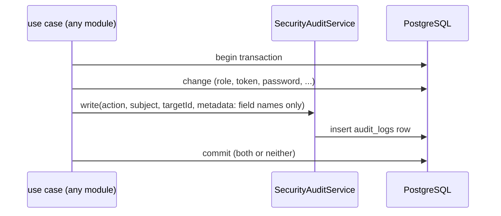

# Security audit: flow

Part of the [project spec](../../../SPEC.md). Flow `security-audit`: [SPEC.md](SPEC.md) (what it must do) · [FLOW.md](FLOW.md) (steps and modules) · [RULES.md](RULES.md) (rules every change must keep).

## Actors

- **Any module with a security event**: writes the row in its own transaction.
- **Owner**: reads `GET /audit-logs`.

## Steps

1. A use case changes security state (for example a role's permissions).
2. In the same transaction it calls `SecurityAuditService` with the action, subject, target and metadata (field names only, never values; emails as HMAC).
3. The row commits or rolls back with the change. A login failure writes a standalone row.
4. The owner reads the log.

## Modules in this flow

<!-- flow-modules:start (generated by .claude/bin/module-index from `modules:`; edit only the Role column) -->
<!-- prettier-ignore-start -->

| Module | Role in this flow | Doc |
|---|---|---|
| `apps/cms-api/src/modules/security-audit` | `SecurityAuditService`, `writeAuditLog`, audit actions and reasons, email HMAC | [security-audit.md](../../modules/cms-api/security-audit.md) |
| `apps/cms-api/src/modules/identity` | Writes login, 2FA, password, owner, seed and re-authentication events | [identity.md](../../modules/cms-api/identity.md) |
| `apps/cms-api/src/modules/access` | Writes role, permission, account and token events | [access-control.md](../../modules/access-control.md) |
| `apps/cms-api/src/modules/media` | Writes media delete events | [media.md](../../modules/cms-api/media.md) |
| `apps/cms-api/src/modules/reviewer` | Writes reviewer toggle events | none yet |
| `apps/cms-api/src/modules/backups` | Writes backup link events | [backups.md](../../modules/backups.md) |

<!-- prettier-ignore-end -->
<!-- flow-modules:end -->
