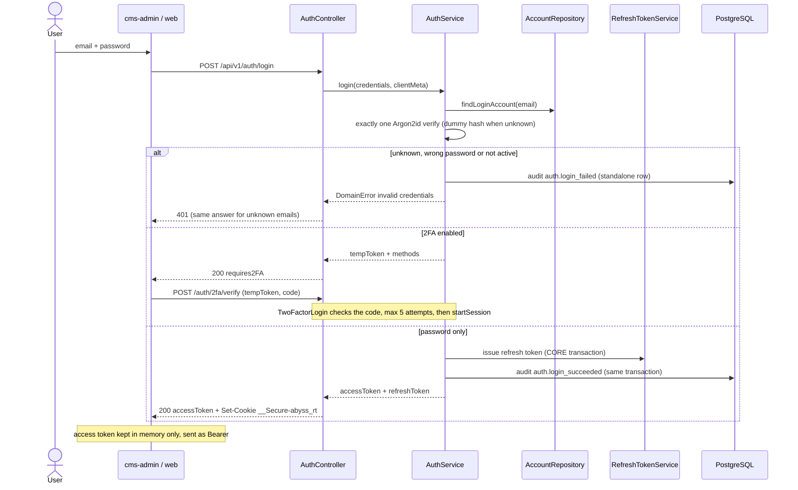
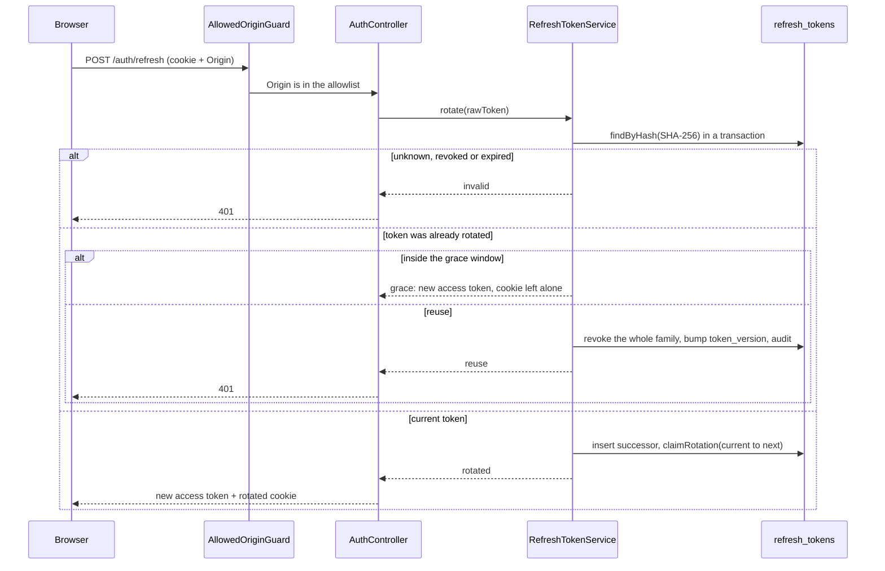
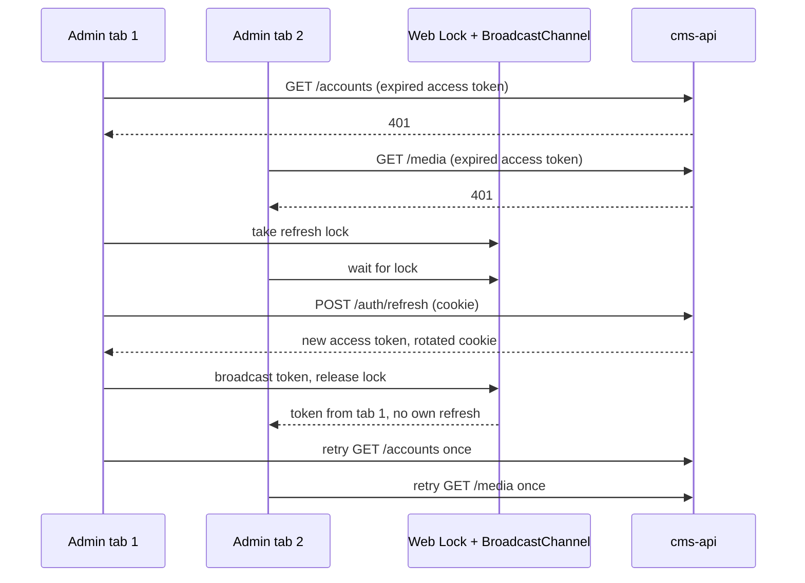
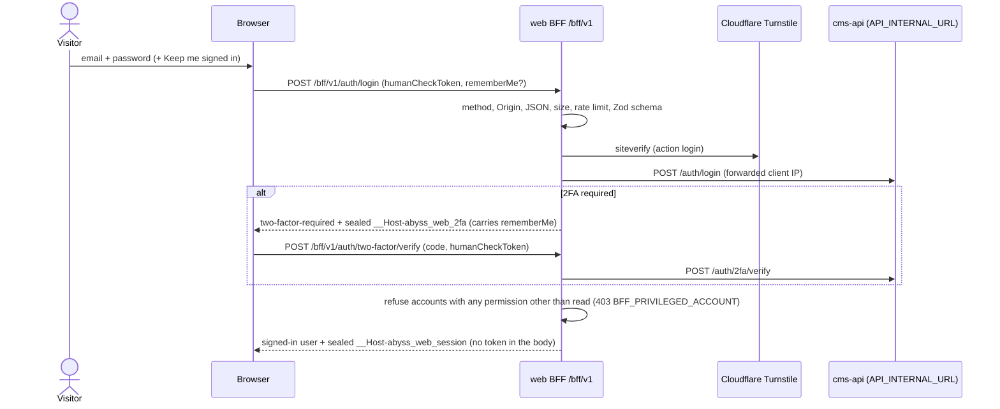

# Sign-in: flow

Part of the [project spec](../../../SPEC.md). Flow `sign-in`: [SPEC.md](SPEC.md) (what it must do) · [FLOW.md](FLOW.md) (steps and modules) · [RULE.md](RULE.md) (rules every change must keep).

## Actors

- **User**: an invited account (editor, admin, owner) signing in to cms-admin, or a visitor with an account signing in on the web site.
- **cms-admin**: keeps the access token in memory and sends it as a Bearer header; the refresh token is the `__Secure-abyss_rt` cookie (D14).
- **web BFF**: Next.js Route Handlers under `/bff/v1`; holds both cms-api tokens in the sealed `__Host-abyss_web_session` cookie (D21).
- **cms-api identity**: checks credentials and the second factor, issues and rotates tokens.

## Steps

1. The user sends email, password and the remember-me choice (`POST /auth/login`; web: `POST /bff/v1/auth/login` with a Turnstile token).
2. cms-api runs exactly one Argon2id verify (a dummy hash for an unknown email) and answers unknown, wrong and inactive accounts the same way (D8).
3. 2FA off: the session starts at once (`AuthService.startSession`). 2FA on: cms-api answers with a 2FA temp token (TTL 300 s, 5 attempts) that carries the remember-me claim `rm`; the user sends the code to `POST /auth/2fa/verify` (email code: `POST /auth/2fa/email-challenge` first), and the session starts with the claim's value (RM-1).
4. Starting a session issues the refresh token row (with `remember_me` and the TTL of that mode) and writes `auth.login_succeeded` in the same transaction (RM-2, RM-4).
5. cms-admin gets the access token in the body and the refresh cookie, persistent only when remembered (RM-3). The web BFF seals both tokens into `__Host-abyss_web_session`, persistent only when remembered (RM-6); the browser gets no token.
6. Refresh: cms-admin calls `POST /auth/refresh` with the cookie (Origin checked, D14), one tab at a time (Web Lock + BroadcastChannel); the BFF refreshes server-side when the access token has under 30 s left. Each rotation keeps the family's mode; reuse of a rotated token revokes the family (D9).
7. Sign-out: `POST /auth/logout` (web: `POST /bff/v1/auth/logout`, which always clears both cookies).

## Login, with and without 2FA

Source: [docs/architecture/07-flows.html](../../architecture/07-flows.html) (generated 2026-10-26; before remember me, which adds `rememberMe` to the login body, the `rm` claim to the temp token and the cookie mode to step 5).

## Refresh token rotation and reuse detection (D9, D14)

## cms-admin: refresh across tabs

Without Web Locks each tab refreshes and the grace window covers the overlap.

## Web sign-in through the BFF (D21)

## Modules in this flow

<!-- flow-modules:start (generated by .claude/bin/module-index from `modules:`; edit only the Role column) -->
<!-- prettier-ignore-start -->

| Module | Role in this flow | Doc |
|---|---|---|
| `apps/cms-api/src/modules/identity` | Login, 2FA verify, access tokens, refresh rotation, logout, the refresh cookie (RM-1..RM-3) | [identity.md](../../modules/cms-api/identity.md) |
| `apps/cms-api/src/modules/security-audit` | `auth.login_succeeded` / `auth.login_failed` rows (D15, RM-4) | [security-audit.md](../../modules/cms-api/security-audit.md) |
| `apps/cms-admin/src/features/auth` | Session, in-memory access token, refresh interceptor, single-flight and cross-tab refresh, login API client | [auth.md](../../modules/cms-admin/auth.md) |
| `apps/cms-admin/src/views/login` | Sign-in page with the 2FA modal and the remember-me checkbox (RM-5) | [login.md](../../modules/cms-admin/login.md) |
| `apps/web/src/features/auth` | Web login dialog, Turnstile widget (D21, RM-6) | none yet |
| `apps/web/src/features/session` | Who is signed in; the sealed BFF session cookie server-side (D21, RM-6) | none yet |
| `packages/form-commons/src/components/forms` | `CheckboxInput` used by the remember-me checkbox (RM-5) | [forms.md](../../modules/form-commons/forms.md) |

<!-- prettier-ignore-end -->
<!-- flow-modules:end -->
