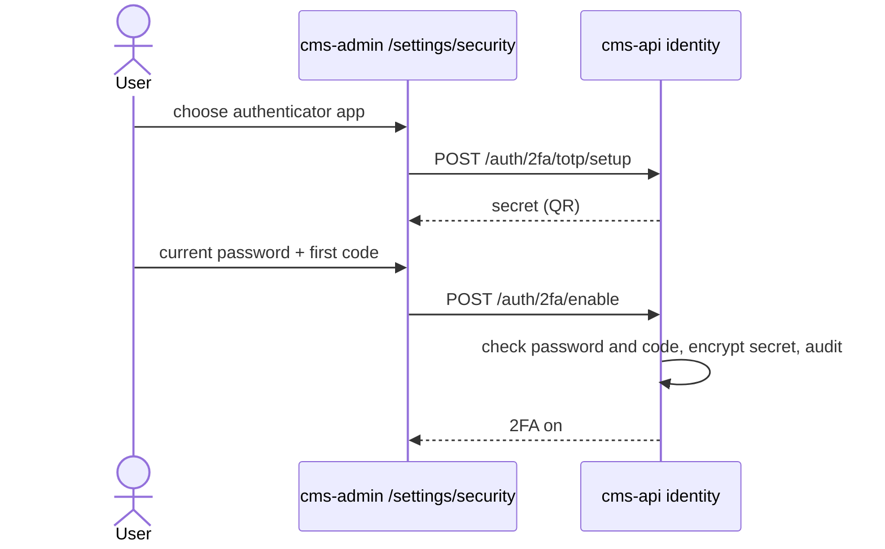

# Two-factor setup: flow

Part of the [project spec](../../../SPEC.md). Flow `two-factor-setup`: [SPEC.md](SPEC.md) · [FLOW.md](FLOW.md) · [RULES.md](RULES.md).

## Actors

- **User**: a signed-in account on `/settings/security`.
- **cms-api identity**: creates the TOTP secret, checks codes, stores the method.

## Steps

1. TOTP: `POST /auth/2fa/totp/setup` returns the secret (QR) for the authenticator app.
2. The user sends the current password and the first code to `POST /auth/2fa/enable`; cms-api checks both, stores the secret encrypted (AES-256-GCM, `TOTP_ENC_KEY` with a key id) and the method, and writes an audit row.
3. Email method: codes are mailed with purpose `LOGIN_2FA_EMAIL`; the page shows the warning that email compromise means account takeover (Q3).
4. Remove: `POST /auth/2fa/disable` with password and code; audit row.

## Modules in this flow

<!-- flow-modules:start (generated by .claude/bin/module-index from `modules:`; edit only the Role column) -->
<!-- prettier-ignore-start -->

| Module | Role in this flow | Doc |
|---|---|---|
| `apps/cms-api/src/modules/identity` | TOTP secret, enable and disable, email code, secret encryption, `owner:reset-2fa` CLI | [identity.md](../../modules/cms-api/identity.md) |
| `apps/cms-api/src/modules/security-audit` | Audit rows for 2FA changes (D15) | [security-audit.md](../../modules/cms-api/security-audit.md) |
| `apps/cms-api/src/infrastructure/mail` | Sends email codes | [mail.md](../../modules/cms-api/mail.md) |
| `apps/cms-admin/src/features/security` | Two-factor setup client | [security.md](../../modules/cms-admin/security.md) |
| `apps/cms-admin/src/views/security-settings` | Two-factor setup and removal page (`/settings/security`) | [security-settings.md](../../modules/cms-admin/security-settings.md) |

<!-- prettier-ignore-end -->
<!-- flow-modules:end -->
